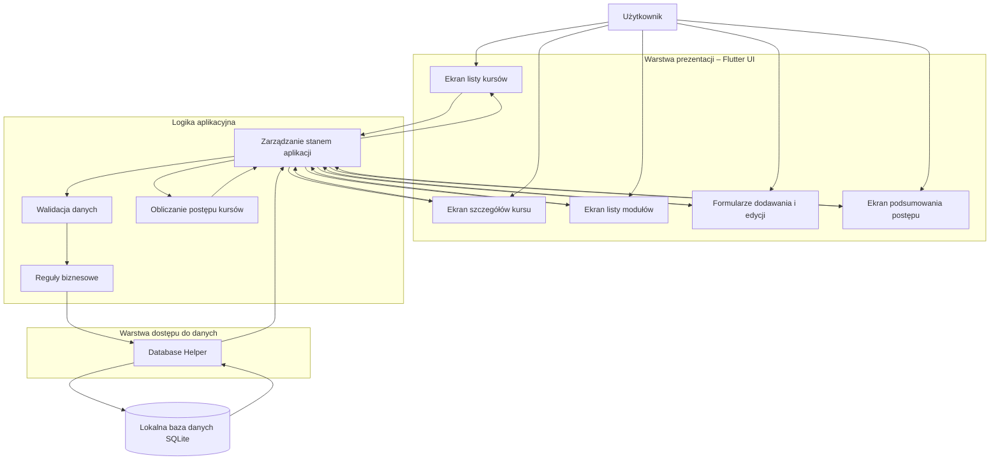
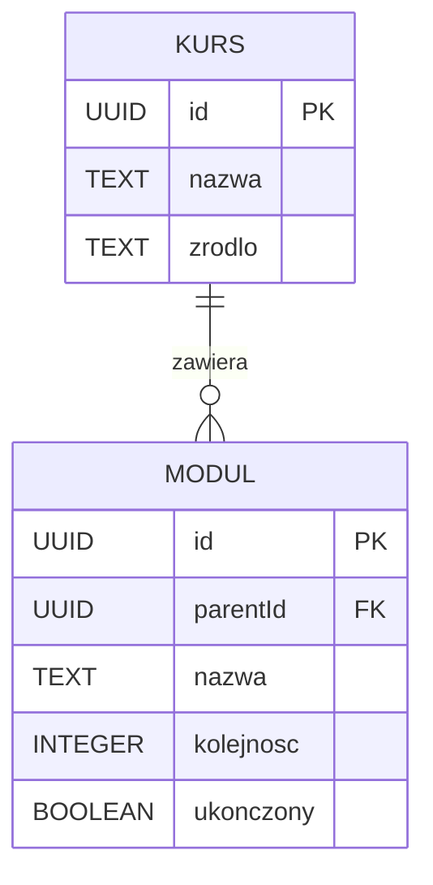
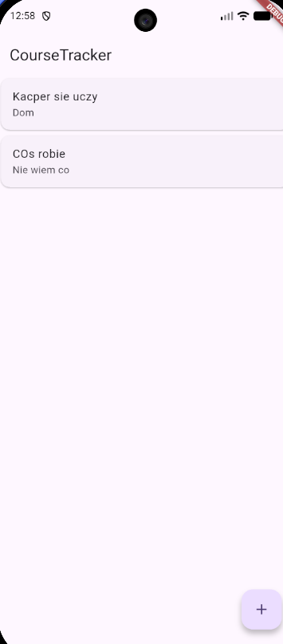
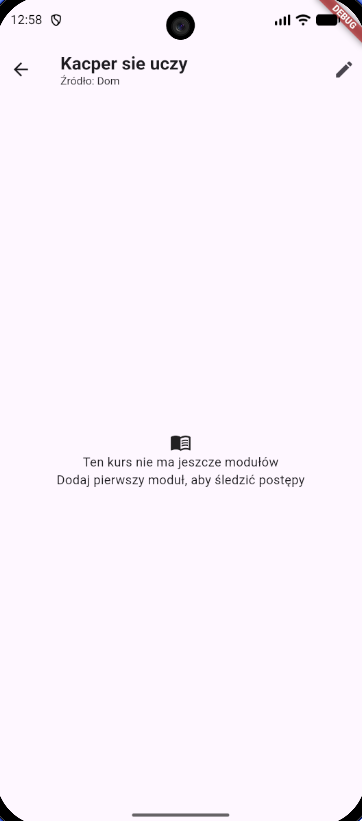
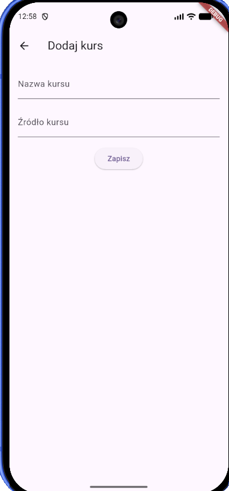
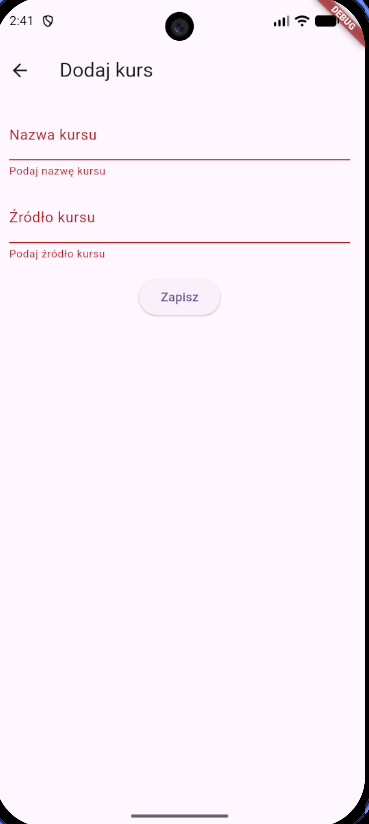

# Sprawozdanie — Laboratorium 2

**Przedmiot:** Budowa aplikacji mobilnych z użyciem technologii frontendowych  
**Student / identyfikator: Kacper Czernecki / 147482**  
**Projekt biznesowy: MOB-[20] — [CourseTracker]**
**Framework: [Flutter]**  
**Data zajęć: [2026-11-05]**  
**Repozytorium: [odnośnik](https://github.com/KacperCzernecki/MOB-020-CourseTracker)**  
**Commit / tag odpowiadający oddaniu:** []

## T1. Analiza podejść do tworzenia aplikacji

**Cel:** świadomy wybór podejścia w kontekście wymagań własnego projektu.

1. Wymień trzy wymagania biznesowe/niefunkcjonalne swojego projektu, które wpływają na wybór technologii.
2. Porównaj podejście natywne, hybrydowe WebView, wieloplatformowe i PWA pod kątem tych wymagań.
3. Uzasadnij, dlaczego wybrany w laboratorium 1 framework pozostaje odpowiedni, albo opisz zmianę decyzji.

| Wymaganie z projektu                       | Znaczenie dla wyboru technologii                                                                                                                                 | Wniosek                                                                                                            |
| ------------------------------------------ | ---------------------------------------------------------------------------------------------------------------------------------------------------------------- | ------------------------------------------------------------------------------------------------------------------ |
| Trwały zapis danych lokalnie               | Aplikacja musi przechowywać kursy i moduły wraz z relacjami między nimi. Dane powinny być dostępne również po zamknięciu i ponownym uruchomieniu aplikacji       | Technologia powinna zapewniać obsługę lokalnej bazy danych lub trwałego magazynu danych.                           |
| Obsługa CRUD i relacji między encjami      | Aplikacja musi umożliwiać dodawanie, przeglądanie, edycję i usuwanie modułów oraz zarządzanie kursami. Konieczna jest również kontrola powiązań między rekordami | Framework powinien ułatwiać tworzenie formularzy, list, widoków szczegółowych oraz zarządzanie stanem aplikacji    |
| Responsywny i intuicyjny interfejs mobilny | Użytkownik powinien móc wygodnie zarządzać kursami i monitorować postępy na urządzeniu mobilnym. Interfejs musi być dostosowany do różnych rozmiarów ekranów     | Wybrana technologia powinna umożliwiać tworzenie responsywnych interfejsów oraz zapewniać wygodną obsługę dotykową |

**Porównanie podejść i uzasadnienie:**

1. **Podejście natywne:** Polega na tworzeniu aplikacji osobno dla konkretnego systemu operacyjnego, np. Androida lub iOS. Wykorzystuje języki i narzędzia dedykowane danej platformie
   - **Zalety:** wysoka wydajność, pełny dostęp do funkcji urządzenia, dobre dopasowanie interfejsu do systemu

   - **Wady:** konieczność tworzenia i utrzymywania osobnych wersji aplikacji, większy nakład pracy oraz znajomość różnych technologii.

   - **Ocena dla Projektu:** podejście zapewniałoby odpowiednią funkcjonalność, ale byłoby niepotrzebnie czasochłonne dla aplikacji o stosunkowo prostej logice biznesowej

2. **Podejście hybrydowe WebView:** Polega na tworzeniu interfejsu za pomocą technologii internetowych, takich jak HTML, CSS i JavaScript, a następnie uruchamianiu go wewnątrz natywnej powłoki aplikacji za pomocą WebView
   - **Zalety:** możliwość wykorzystania znanych technologii frontendowych, współdzielenie kodu oraz stosunkowo szybkie tworzenie aplikacji

   - **Wady:** zależność od komponentu WebView, możliwe ograniczenia wydajnościowe oraz konieczność korzystania z dodatkowych mechanizmów przy dostępie do funkcji urządzenia

   - **Ocena dla Projektu:** rozwiązanie jest wystarczające do obsługi formularzy, list, filtrowania i lokalnego zapisu danych

3. **Podejście wieloplatformowe:** Umożliwia tworzenie aplikacji na różne systemy operacyjne z wykorzystaniem wspólnego kodu źródłowego. Przykładami technologii są React Native i Flutter
   - **Zalety:** współdzielenie logiki biznesowej, możliwość tworzenia aplikacji na Androida i iOS oraz dostęp do funkcji urządzenia

   - **Wady:** konieczność poznania specyfiki frameworka, możliwe ograniczenia w przypadku bardziej zaawansowanych funkcji natywnych oraz zależność od dodatkowych bibliotek

   - **Ocena dla Projektu:** jest to dobre rozwiązanie, ponieważ pozwala stworzyć aplikację mobilną z rozbudowanym interfejsem, formularzami i trwałym zapisem danych bez konieczności utrzymywania dwóch niezależnych projektów

4. **PWA:** Jest to aplikacja internetowa, którą można instalować na urządzeniu i uruchamiać w sposób zbliżony do tradycyjnej aplikacji mobilnej
   - **Zalety:** wykorzystanie standardowych technologii webowych, łatwe wdrażanie aktualizacji, możliwość działania offline przy odpowiedniej konfiguracji oraz brak konieczności publikowania aplikacji w sklepach

   - **Wady:** ograniczenia dostępu do niektórych funkcji urządzenia, różnice w obsłudze poszczególnych przeglądarek i systemów operacyjnych

   - **Ocena dla Projektu:**

**Wskazane źródła (dokumentacja, artykuły techniczne):**

- ["Tworzenie aplikacji mobilnej: Główne typy i ich różnice" - Innowise.com](https://innowise.com/pl/blog/mobile-app-development-types-processes/)
- [Flutter docs](https://docs.flutter.dev/)

## T2. Projekt architektury aplikacji

**Cel:** zaprojektowanie struktury umożliwiającej dalszy rozwój i testowanie.

### T2.1. Diagram architektury

Dodaj diagram (np. Mermaid w Markdown lub obraz w `docs/diagrams/`) przedstawiający:

- ekrany i komponenty UI;
- zarządzanie stanem / logikę aplikacyjną;
- warstwę dostępu do danych;
- lokalne trwałe źródło danych;
- kierunek przepływu danych.

**Diagram / odnośnik:**

### T2.2. Model danych

Zdefiniuj co najmniej dwie powiązane encje wynikające z indywidualnych wymagań biznesowych.

| Encja     | Pole | Typ    | Wymagane | Znaczenie |
| --------- | ---- | ------ | -------- | --------- |
| Kurs | id | UUID | Tak      | Unikalny identyfikator kursu    |
| Moduł | parentId | UUID | Tak      | 	Identyfikator kursu, do którego przypisany jest moduł    |

**Relacja i sposób zapewnienia spójności (np. usuwanie encji nadrzędnej):**

* PK - Primary key
* FK - Foreign key

### T2.3. Decyzje projektowe

| Decyzja                | Wybrane rozwiązanie | Alternatywa | Uzasadnienie |
| ---------------------- | ------------------- | ----------- | ------------ |
| Zarządzanie stanem     | StatefulSidget                | Provider, Riverpod         | Aplikacja ma niewielki zakres więc wbudowane zarządzanie stanem wystarczy        |
| Przechowywanie danych  | sqflite                 |      Hive    |    Dane są relacyjne: jeden kurs może mieć wiele modułów       |
| Nawigacja              | Navigator + MaterialPageRoute                 | Autoroute         | Aplikacja ma prostą strukturę ekranów, więc natywna nawigacja Fluttera jest wystarczająca          |
| Separacja logiki od UI | Services                 | Bloc         | Oddzielenie modeli i operacji bazodanowych od ekranów ułatwi utrzymanie i testowanie aplikacji          |

**Plik `docs/architecture.md`:** [link do pliku](../architecture.md)

## T3. Nawigacja i ekrany

**Cel:** przygotowanie struktury interfejsu aplikacji.

Zaimplementuj minimum trzy ekrany:

1. listę rekordów;
2. szczegóły wybranego rekordu;
3. formularz dodawania (może być później użyty także do edycji).

**Schemat nawigacji:**

[diagram / opis]

| Ekran     | Plik / komponent | Przejście do / z ekranu | Dowód działania |
| --------- | ---------------- | ----------------------- | --------------- |
| Lista     | widgets/course_list.dart              | Ekran główny aplikacji                     |          |
| Szczegóły | screens/course_details_screen.dart              | Szczegóły kursu / Ekran główny                      |          |
| Formularz | screens/add_course_screen.dart              | Formularz dodawania kursu / Ekran główny                     |        |

**Dlaczego taki układ nawigacji jest odpowiedni dla użytkownika?**

Użytkownik nie musi szukać przycisku na menu tylko posiada kursy oraz przycisk dodawania na jednym ekranie przez co nie zniechęci się, a korzystanie z aplikacji będzie szybkie i wygodne

## T4. Operacje Create i Read

**Cel:** implementacja pierwszych operacji CRUD z trwałym przechowywaniem danych.

Zaimplementuj:

- dodanie rekordu głównej encji;
- walidację minimum dwóch pól;
- zapis rekordu w lokalnym trwałym magazynie danych;
- odczyt i wyświetlenie listy rekordów;
- otwarcie szczegółów wybranego rekordu.

**Powiązanie z wymaganiami biznesowymi (ID wymagań):** 

| Operacja         | Lokalizacja kodu | Reguła walidacji / zachowanie | Wynik |
| ---------------- | ---------------- | ----------------------------- | ----- |
| Create           | `screens/add_course_screen.dart`, `main.dart`, `services/database_service.dart`              | Wymagana nazwa kursu i jego źródło - ID generowane jako UUI v4. Dane zapisywane w tabeli `courses `                          | Kurs zostaje zapisany w SQLite i pojawia się na liście   |
| Read (lista)     | `main.dart`, `widgets/course_list.dart`,`services/database_service.dart`              | Pobierane są wszystkie kursy z tabeli `courses` podczas uruchamiania aplikacji                           | Lista kursów wyświetla zapisane dane, również po ponownym uruchomieniu aplikacji   |
| Read (szczegóły) | `screens/course_details_screen.dart`, `main.dart`             | Po wybraniu kursu przekazywany jest jego obiekt do ekranu szczegółów                          | Wyświetlana jest nazwa i źródło wybranego kursu   |

**Wyjaśnij przepływ danych po naciśnięciu przycisku „Zapisz”:**

1. **UI -** Użytkownik wpisuje nazwę i źródło kursu, a następnie naciska przycisk „Zapisz
2. **Walidacja -** Formularz sprawdza, czy wymagane pola nie są puste. Jeśli walidacja się powiedzie, generowany jest unikalny identyfikator UUID v4
3. **Utworzenie obiektu -** Na podstawie danych z formularza tworzony jest obiekt `Course`
4. **Przekazywanie danych -** Obiekt `Course` jest zwracany do `HomeScreen` za pomocą `Navigator.pop`
5. **Logika aplikacji -** `HomeScreen` odbiera obiekt kursu i przekazuje go do metody `insertCourse()` w `DatabaseService`
6. **Zapis w bazie -** `DatabaseService` otwiera lub wykorzystuje istniejące połączenie z SQLite i zapisuje kurs w tabeli `courses`
7. **Odświeżenie widoku -** Po poprawnym zapisie `HomeScreen` wywołuje `setState()` i dodaje nowy kurs do listy przechowywanej w pamięci, a Flutter ponownie buduje odpowiednie widgety dzięki czemu widać nowu kurs.

## T5. Weryfikacja działania i wnioski

Przeprowadź testy manualne i podaj rzeczywiste wyniki.

| ID    | Scenariusz                           | Oczekiwany rezultat             | Wynik (PASS/FAIL) | Dowód / uwagi |
| ----- | ------------------------------------ | ------------------------------- | ----------------- | ------------- |
| TC-01 | Dodanie poprawnego rekordu           | Rekord jest zapisany i widoczny | PASS               |             |
| TC-02 | Próba zapisu pustego wymaganego pola | Zapis zablokowany, komunikat    | PASS               |            |
| TC-03 | Otwarcie szczegółów rekordu          | Poprawne dane rekordu           | PASS               | Nie zaimplementowano opcji dodawania modułów więc widać tylko title i source           |
| TC-04 | Ponowne uruchomienie aplikacji       | Rekord pozostaje dostępny       | PASS               | Wymagało zaimplementowanie biblioteki `sqflite` i `uuid`           |
| TC-05 | Brak rekordów                        | Czytelny stan pustej listy      | PASS               | Pokazano na przykładzie braku modułów           |

**Najważniejszy napotkany problem i sposób rozwiązania:**

Największym problemem napotkanym podczas mojej dotychczasowej pracy nad projektem było poprawne zaimplementowanie bazy danych. Podczas testowania aplikacji dałem id kursu jako test.id tymczasowo i o tym zapomniałem co spowodowało, że żaden drugi rekord nie chciał zostać zapisany przez regułę oryginalności id

**Co wymaga dalszej pracy przed laboratorium 3?**

Uważam, że będę bardziej się przyłożyć do obsługi wyjątków.

**Wnioski (3–6 zdań, odnoszące się do własnej implementacji):**

Podczas implementacji aplikacji CourseTracker stworzyłem podstawową strukturę aplikacji obejmującą listę kursów, ekran szczegółów oraz formularz dodawania. Zastosowanie SQLite umożliwiło trwałe przechowywanie danych, dzięki czemu kursy pozostają dostępne po ponownym uruchomieniu aplikacji. Jednym z największych wyzwań było zapewnienie unikalnych identyfikatorów kursów, co rozwiązałem za pomocą UUID v4. Podział projektu na modele, ekrany, widgety i warstwę dostępu do bazy danych ułatwił organizację kodu. Przed kolejnym etapem muszę jeszcze zaimplementować obsługę modułów, edycję kursów oraz funkcje wyszukiwania, filtrowania i sortowania.

## Materiały dowodowe i historia pracy

- Issue(s): [link](https://github.com/KacperCzernecki/MOB-020-CourseTracker/issues/4)
- Pull Request(s): [link](https://github.com/KacperCzernecki/MOB-020-CourseTracker/pull/5)
- Commity związane z laboratorium: [link](https://github.com/KacperCzernecki/MOB-020-CourseTracker/commit/74f8555063db151ece02ba940bfbbaa59fe16d5e)
- Zrzuty ekranu: [Folder ze zrzutami ekranu](../screenshots/)
- Instrukcja uruchomienia: [README.md](../../README.md)

## Użycie narzędzi AI (jeżeli dotyczy)

**Narzędzie i zakres wsparcia:**
* **[Chat GPT](https://chatgpt.com/)** - Pomoc w weryfikowaniu kodu (syntaxu, literówek), pomoc przy weryfikacji sprawozdania oraz raportu 

**Jak zweryfikowano wynik:**   Samodzielnie przeczytano każdą odpowiedź oraz zweryfikowano za pomocą dostępnych dokumentacji

**Elementy wykonane samodzielnie:** Samodzielnie odpowiadałem za pełny cykl wytwarzania oprogramowania: implementację funkcjonalności, zarządzanie wersjami kodu , tworzenie commitów, pobieranie i scalanie zmian, testowanie oraz obsługę i rozwiązywanie zgłoszeń 

**Warunki formalne:** sprawozdanie w Markdown, czytelne odnośniki do działającego kodu i diagramów, zrzuty ekranu renderujące się w repozytorium, identyfikacja autora i projektu. Oceniana jest zarówno implementacja, jak i zdolność wyjaśnienia własnych decyzji. Brak dowodów wykonania może ograniczyć liczbę punktów.
